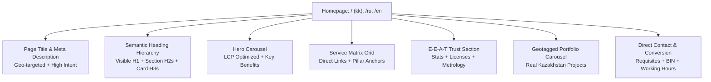
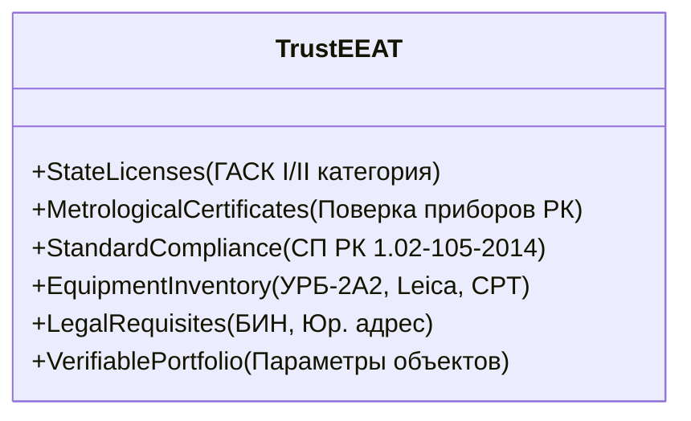
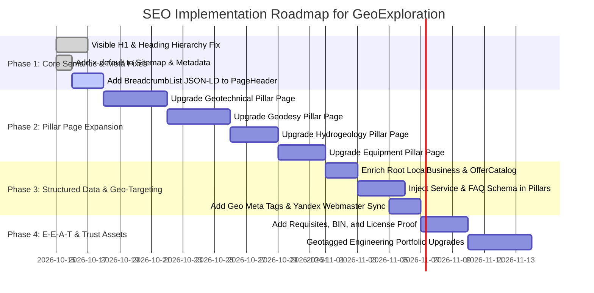

# Comprehensive SEO Research & Architecture Strategy for GeoExploration Service Company Landing

**Document Version:** 1.0.0  
**Target Domain:** `geoexploration.kz`  
**Location:** Astana, Kazakhstan (operating nationwide)  
**Primary Tech Stack:** Next.js 15.5.15 (App Router, Server Components), React 19, TypeScript 5, `next-intl` 4.8.3, Tailwind CSS v4, Sharp 0.35.5  
**Target Engines:** Google Kazakhstan (`google.kz`), Yandex Kazakhstan (`yandex.kz`), Bing / IndexNow  

---

## 1. Executive Summary & Strategic Context

GeoExploration (`geoexploration.kz`) is a specialized B2B and consumer geoscience enterprise operating out of Astana, Kazakhstan. Its service scope encompasses:
1. **Engineering-geological surveys** (*Инженерно-геологические изыскания* / *Инженерлік-геологиялық ізденістер*)
2. **Borehole drilling** (*Бурение скважин* / *Ұңғыма бұрғылау*) — encompassing wireline diamond core extraction (PQ/HQ/NQ) and potable/industrial water well drilling
3. **Geodetic surveying and topography** (*Геодезия и топография* / *Геодезия және топография*)
4. **Hydrogeological exploration & permitting** (*Гидрогеология* / *Гидрогеология*)
5. **Field supplies & specialized equipment** (*Керновые ящики и мешки для проб* / *Керн жәшіктері және сынама қаптары*)

In the Republic of Kazakhstan, search volume for industrial geoscience and borehole drilling is divided across two major search engines: **Google** (accounting for ~65-70% mobile and general share) and **Yandex** (commanding ~30-35% commercial desktop and B2B procurement share). Both engines enforce distinct algorithmic rules:
- **Google** prioritizes Core Web Vitals (INP, LCP, CLS), semantic document structure, mobile-first indexing, canonical localized clustering, and deep E-E-A-T (Experience, Expertise, Authoritativeness, Trustworthiness).
- **Yandex** leans heavily on **commercial ranking factors** (*коммерческие факторы*), physical geo-binding through **Yandex Business** (*Яндекс Бизнес / Справочник*), local requisites (BIN, physical address, direct phone), transparent price framing, rich snippet support (including active FAQ accordions), and real-time indexing protocols (**IndexNow**).

This research report synthesizes primary documentation from Google Search Central, Yandex Webmaster, Schema.org, W3C, and Next.js 15 into an actionable SEO blueprint tailored specifically to GeoExploration's code architecture.

---

## 2. Primary Documentation & Normative Sources

Every recommendation in this document is derived directly from authoritative primary sources:

### 2.1 Google Search Central
- **Google Search Essentials**:
  URL: `https://developers.google.com/search/docs/essentials`  
  *Key Mandate:* Technical requirements for crawling and indexing; strict avoidance of deceptive doorways; semantic parity between desktop and mobile.
- **Local Business Structured Data**:
  URL: `https://developers.google.com/search/docs/appearance/structured-data/local-business`  
  *Key Mandate:* Use specific schema subtypes (`ProfessionalService` / `LocalBusiness`); exact Name-Address-Phone (NAP) consistency across website, Google Business Profile, and markup.
- **International & Multilingual SEO (`hreflang`)**:
  URL: `https://developers.google.com/search/docs/specialty/international/localized-versions`  
  *Key Mandate:* Bi-directional link relationships between language alternates; necessity of `hreflang="x-default"` for default landing URLs; language vs. regional tag matching (`kk`, `ru`, `en`).
- **Core Web Vitals & Page Experience**:
  URL: `https://developers.google.com/search/docs/appearance/core-web-vitals`  
  URL: `https://web.dev/explore/metrics`  
  *Key Mandate:* **INP** (Interaction to Next Paint) $\le$ 200 ms (replaced FID as official Core Web Vital in March 2024); **LCP** (Largest Contentful Paint) $\le$ 2.5 s; **CLS** (Cumulative Layout Shift) $\le$ 0.1.
- **Breadcrumb Structured Data**:
  URL: `https://developers.google.com/search/docs/appearance/structured-data/breadcrumb`  
  *Key Mandate:* Mandatory sequential position indexing starting at 1; exact match to visible breadcrumb trail.
- **FAQ Structured Data**:
  URL: `https://developers.google.com/search/docs/appearance/structured-data/faqpage`  
  URL: `https://developers.google.com/search/blog/2023/08/howto-faq-changes`  
  *Key Context:* While Google narrowed FAQ rich snippets in August 2023 primarily to authoritative institutions, Yandex actively parses and surfaces interactive FAQ accordions in commercial SERPs.

### 2.2 Yandex Webmaster Documentation
- **Commercial Ranking Factors**:
  URL: `https://yandex.ru/support/webmaster/yandex-indexing/commercial-factors.html`  
  *Key Mandate:* Detailed company requisites (BIN, legal entity, address, city phone code), pricing or price estimation tools, transparent service descriptions, warranty, and portfolio.
- **Regional Geo-Targeting (Региональность)**:
  URL: `https://yandex.ru/support/webmaster/regions/`  
  *Key Mandate:* Geo-dependent queries (*геозависимые запросы*) require explicit regional assignment in Yandex Webmaster and verification through Yandex Business.
- **Yandex Business & Yandex Maps Integration**:
  URL: `https://yandex.ru/support/sprav/`  
  *Key Mandate:* Synchronization between verified organization profile (ratings, working hours, geo-coordinates, catalog) and SERP snippets.
- **IndexNow Protocol**:
  URL: `https://yandex.com/support/webmaster/indexnow/`  
  URL: `https://www.indexnow.org/documentation`  
  *Key Mandate:* Automated instantaneous notification of URL changes using hosted key verification (`/<key>.txt`) and JSON POST payload to `https://yandex.com/indexnow`.

### 2.3 Schema.org Specifications
- **`ProfessionalService` / `LocalBusiness`**:
  URL: `https://schema.org/ProfessionalService`, `https://schema.org/LocalBusiness`
- **`Service`**:
  URL: `https://schema.org/Service`  
  *Key Properties:* `serviceType`, `provider`, `areaServed`, `hasOfferCatalog`, `offers`.
- **`OfferCatalog` & `Offer`**:
  URL: `https://schema.org/OfferCatalog`  
  *Key Properties:* Hierarchical categorization of services (`itemListElement`).
- **`BreadcrumbList`**:
  URL: `https://schema.org/BreadcrumbList`
- **`Organization`**:
  URL: `https://schema.org/Organization`  
  *Key Properties:* `taxID` (Business Identification Number - BIN), `knowsAbout`, `hasCredential`.

### 2.4 Next.js 15 Documentation
- **Metadata API & MetadataRoute**:
  URL: `https://nextjs.org/docs/app/api-reference/functions/generate-metadata`  
  URL: `https://nextjs.org/docs/app/api-reference/file-conventions/metadata/sitemap`  
  URL: `https://nextjs.org/docs/app/api-reference/file-conventions/metadata/robots`  
  *Key Mechanics:* Server Component metadata evaluation, dynamic sitemap XML generation with language alternates, `<script type="application/ld+json">` without client-side hydration penalty.

---

## 3. Audit of Current GeoExploration SEO State

An in-depth inspection of the repository (`src/app/[locale]/layout.tsx`, `src/app/[locale]/page.tsx`, `src/widgets/**`, `src/entities/service/**`, `messages/**`, `docs/adr/0004-*`) identified both significant strengths and critical optimization opportunities.

### 3.1 Existing Strengths
1. **IndexNow Pipeline Implemented**: `scripts/submit-indexnow.ts` dynamically pulls all URLs from `sitemap.ts` and pushes them to both `yandex.com/indexnow` and `api.indexnow.org/indexnow`.
2. **Next.js 15 Server-Side Rendering**: Core pages are rendered on the server with zero unnecessary client hydration overhead.
3. **Optimized LCP Hero Asset**: `HeroCarousel.tsx` uses `/assets/images/bgbg.webp` with Next.js `<Image priority fetchPriority="high" quality={70} />`.
4. **Drilling Pillar Page (`/services/drilling`)**: Successfully expanded with technical fleet specs (URB-2A2, Boart Longyear), wireline core drilling details, interactive FAQ, and matching JSON-LD `FAQPage` and `Service` schema (established in ADR 0004).
5. **Speculation Rules API**: Injected in `layout.tsx` for instant subpage prefetching on Chromium browsers.

### 3.2 Critical Deficiencies & Gaps

| Area | Current Implementation | SEO Risk / Defect |
| :--- | :--- | :--- |
| **Homepage Heading Structure** | `<h2 id="hero-heading" className="sr-only">` inside `HeroCarousel.tsx`. No `<h1>` exists on the entire homepage! | **Severe**: Search engines cannot identify the core document subject or primary commercial entity keyword on the root landing page. |
| **Heading Hierarchy** | Hero slides use `<h3>`, while section headers use `<h2>` (`Наши услуги`, `О компании`, `Наши работы и проекты`). | **Broken Outline**: The document outline skips level 1 entirely (`H2 (hidden) -> H3 -> H2`), violating W3C semantic guidelines and weakening keyword weighting. |
| **Service Pages Disparity** | `/services/drilling` is a comprehensive pillar; but `/services/geotechnical`, `/services/geodesy`, `/services/hydrogeology`, `/services/equipment` are thin lists of 3-4 cards. | **Thin Content**: Non-drilling category pages lack technical specs, workflows, FAQs, and normative references, failing to rank for high-value queries. |
| **Structured Data Scope** | `layout.tsx` contains root `LocalBusiness`, but lacks `hasOfferCatalog`, `knowsAbout`, `taxID` (BIN), and detailed `areaServed`. Non-drilling pages have **zero** `Service` or `FAQPage` schema. | **Missed Rich Snippets**: 4 out of 5 service categories emit no structured data to search crawlers. |
| **Breadcrumb Schema** | `PageHeader.tsx` renders visual breadcrumbs (`<nav><ol>...`), but emits no `BreadcrumbList` JSON-LD markup. | **Lost SERP Real Estate**: Google cannot display hierarchical breadcrumb trails in search snippets. |
| **Internationalization (`hreflang`)** | `layout.tsx` and `sitemap.ts` provide `kk`, `ru`, `en`, but omit the mandatory `x-default` alternate fallback. | **Suboptimal Fallback**: Unmatched visitors or bots are left to algorithmic language guessing rather than landing on the authoritative root. |
| **Regional Geo Meta Tags** | No `geo.region`, `geo.placename`, `geo.position`, or `ICBM` meta tags are present in HTML headers. | **Regionality Blind Spot**: Legacy search bots, geographic parsers, and Yandex crawlers miss quick geo-coordinate resolution. |
| **E-E-A-T & Trust Proof** | No explicit display of State License categories (РГП "Госэкспертиза", Лицензия ГАСК I/II категории), metrological calibration certificates, or company BIN in layout/footer. | **Lower Commercial Score**: Yandex algorithms penalize B2B sites lacking verifiable legal requisites (*реквизиты*). |

---

## 4. Homepage Landing SEO Architecture

The homepage is the primary landing destination and domain authority anchor. Its architectural components must be structured as follows:



### 4.1 Resolving the Missing `<h1>` & Semantic Heading Hierarchy
Search engine crawlers rely on the `<h1>` element as the principal thematic summary of the document. The current practice of having only an `sr-only` `<h2>` must be replaced immediately.

#### Recommended Heading Architecture:
1. **`<h1>` Element**:
   - Location: Integrated directly into the Hero section (either as the top badge/heading or as the authoritative semantic page title above/within the slider).
   - Visibility: Must be visually rendered or prominently styled to establish clear topical hierarchy.
   - Localized Strings:
     - **Kazakh (`kk`)**: `"Астана мен Қазақстандағы кешенді инженерлік-геологиялық ізденістер және ұңғыма бұрғылау"`
     - **Russian (`ru`)**: `"Инженерно-геологические изыскания и бурение скважин в Астане и Казахстане"`
     - **English (`en`)**: `"Engineering-Geological Surveys & Borehole Drilling in Astana, Kazakhstan"`
2. **`<h2>` Section Elements**:
   - `Hero Carousel`: Slides describe individual core competencies. The slide title can remain `<h2>` or `<h3>` subordinated to the main `<h1>`.
   - `Services Grid`: `<h2 id="services-heading">{t("heading")}</h2>` (*"Наши услуги"* / *"Біздің қызметтер"*)
   - `About Section`: `<h2 id="about-heading">{t("heading")}</h2>` (*"Комплексные инженерные решения"* / *"Кешенді инженерлік шешімдер"*)
   - `Portfolio Section`: `<h2 id="portfolio-heading">{t("heading")}</h2>` (*"Наши работы и проекты"* / *"Біздің жобаларымыз"*)
   - `Video Section`: `<h2 id="video-heading">{t("heading")}</h2>`
   - `Contact Section`: `<h2 id="contact-heading">{t("heading")}</h2>` (*"Контактная информация и заказ"* / *"Байланыс ақпараты"*)
3. **`<h3>` Child Elements**:
   - Individual Service Cards within `ServicesGrid` (`ServiceCard.tsx`).
   - Individual Project Titles in `PortfolioSection`.

### 4.2 Geo-Anchored Service Keyword Matrix
To capture high-intent commercial traffic in Kazakhstan, headings, body copy, and metadata must systematically integrate specific localized terminology:

| Discipline | Russian Keywords (`ru`) | Kazakh Keywords (`kk`) | English Keywords (`en`) |
| :--- | :--- | :--- | :--- |
| **Borehole Drilling** | бурение скважин в Астане, бурение на воду под ключ, колонковое бурение скважин, отбор керна PQ HQ NQ, буровая установка УРБ-2А2, паспорт скважины | Астанада ұңғыма бұрғылау, суға ұңғыма қазу, бағаналық бұрғылау, керн алу, бұрғылау қондырғысы, ұңғыма паспорты | borehole drilling Astana, water well drilling Kazakhstan, wireline core drilling, PQ HQ NQ core recovery, URB-2A2 drilling rig |
| **Engineering Geology** | инженерно-геологические изыскания Астана, исследование грунтов под фундамент, штамповые испытания, статическое зондирование CPT, СП РК 1.02-105-2014, отчет по геологии | инженерлік-геологиялық зерттеулер Астана, топырақты зертханалық сынау, іргетас геологиясы, топырақ штампы, техникалық есеп | engineering-geological surveys Kazakhstan, soil mechanics testing, plate load test, CPT sounding, geotechnical foundation report |
| **Geodesy & Topography** | геодезия Астана, топографическая съемка 1:500, вынос осей здания в натуру, исполнительная геодезическая съемка, 3D лазерное сканирование, тахеометр Leica | геодезия Астана, топографиялық түсірілім 1:500, ғимарат осьтерін белгілеу, кадастрлық өлшеулер, 3D лазерлік сканерлеу | geodetic survey Astana, topographic mapping 1:500, building axis stakeout, as-built survey, 3D laser scanning |
| **Hydrogeology** | гидрогеологические изыскания, разрешение на специальное водопользование РК, подсчет запасов подземных вод, проект зоны санитарной охраны ЗСО | гидрогеологиялық зерттеулер, арнайы су пайдалану рұқсаты, жер асты суларының қорын бағалау, санитарлық қорғау аймағы | hydrogeological survey Kazakhstan, special water use permit, groundwater reserve estimation, sanitary protection zone |
| **Field Supplies** | керновые ящики купить Казахстан, пластиковые ящики для керна PQ HQ NQ, мешки для геологических проб, хранение керна | керн жәшіктері Қазақстан, сынама қаптары, керн сақтау жәшігі, геологиялық сынама дорбалары | core boxes Kazakhstan, core storage trays PQ HQ NQ, geological sample bags, specimen collection |

### 4.3 Accessible Internal Linking on Service Cards
Google's PageRank algorithm treats descriptive anchor text as a critical contextual signal:
- **Current Pattern**: Service cards in `ServiceCard.tsx` link to category pages with generic anchor text: `"Подробнее →"` / `"Толығырақ →"` / `"Learn more →"`.
- **Optimization**: Retain the clean visual UI, but equip the link with an accessible label that includes the exact service keyword:
  ```tsx
  <Link
    href={`/services/${service.category}`}
    aria-label={`${t(`${service.id}.title`)} – ${tCat(`${service.category}.label`)}`}
    className="..."
  >
    {/* Card Content */}
  </Link>
  ```
- This satisfies Google Webmaster Guidelines for contextual anchor text while maintaining zero visual clutter.

---

## 5. Pillar & Cluster Architecture for Service Landing Pages

To build topical authority, GeoExploration must move away from thin category pages and adopt a **Pillar and Cluster model**. 

While `/services/drilling` was successfully upgraded in ADR 0004, the remaining four category pages must be systematically elevated with deep technical content, normative specifications, workflow timelines, and interactive FAQ accordions.

```
/services/
├── drilling/             [Pillar: Fleet Specs, Core Drilling PQ/HQ/NQ, Water Wells, FAQ, Schema]
├── geotechnical/         [Pillar: Normative Standards, Lab Tests, Soil Probes, Госэкспертиза, FAQ]
├── geodesy/              [Pillar: Leica/GNSS Fleet, Topo 1:500, Axis Stakeout, Architecture Dept, FAQ]
├── hydrogeology/         [Pillar: Water Code RK, Reserve Estimation, Sanitary Zones, Permits, FAQ]
└── equipment/            [Pillar: Polypropylene Specs, Impact Resistance, Dimensions, Packaging, FAQ]
```

### 5.1 Geotechnical Pillar (`/services/geotechnical`)
- **Primary Search Intent**: Construction companies, architects, and design institutes needing geotechnical survey reports for State Expertise approval (*РГП "Госэкспертиза"*).
- **Core Content Blocks**:
  1. **Normative & Regulatory Compliance**: Explicit citation of national building codes: **СП РК 1.02-105-2014** (*Инженерные изыскания для строительства*), **СН РК 1.02-03-2022**, and **ГОСТ 25100-2020** (*Грунты. Классификация*).
  2. **Field Testing Capabilities**: Plate load testing (*штамповые испытания грунтов*), Standard Penetration Testing (SPT), Dynamic Penetration Testing (DPT), and Cone Penetration Testing (CPT).
  3. **Certified Geotechnical Laboratory Specifications**: Density, moisture content, Atterberg limits (liquid/plastic limit), shear strength (direct shear), triaxial compression, deformation modulus ($E$, MPa).
  4. **4-Stage Workflow**:
     - *Этап 1: Рекогносцировка и программа изысканий* (Site inspection and technical assignment according to SP RK).
     - *Этап 2: Полевые буровые работы и отбор монолитов* (Drilling with undisturbed core/monolith preservation).
     - *Этап 3: Лабораторные испытания грунтов и подземных вод* (Physical-mechanical testing in accredited lab).
     - *Этап 4: Камеральная обработка и защита в Госэкспертизе* (Comprehensive report formulation and state expertise approval).
  5. **FAQ Block & Schema**: Addressing borehole density per building footprint, depth requirements for high-rise foundations, and typical reporting turnaround (10-15 business days).

### 5.2 Geodesy & Topography Pillar (`/services/geodesy`)
- **Primary Search Intent**: General contractors and developers needing land demarcation, topographic maps for engineering utilities, and continuous construction monitoring.
- **Core Content Blocks**:
  1. **Instrumentation & Fleet Specifications**: Leica Geosystems FlexLine (TS06/TS07) electronic total stations (angle accuracy 1"-2"), multi-frequency multi-constellation GNSS RTK receivers (GPS, GLONASS, BeiDou, Galileo), and terrestrial 3D laser scanners.
  2. **Scales & Coordinate Systems**: Topographic surveying at scales **1:500, 1:1000, 1:2000, 1:5000**; transformation and georeferencing to state coordinate systems (**СК-42**, **WGS-84**, local municipal systems).
  3. **Municipal Approvals**: Support with registration and approval in regional Architecture and Urban Planning Departments (*Управление архитектуры, градостроительства и земельных отношений*).
  4. **FAQ Block & Schema**: Legal validity of executive schemas, calibration validity of total stations, and turnaround for utility network coordination (*согласование с коммунальными службами*).

### 5.3 Hydrogeology Pillar (`/services/hydrogeology`)
- **Primary Search Intent**: Industrial facilities, agricultural complexes, and commercial developers seeking legal water withdrawal rights and aquifer longevity studies.
- **Core Content Blocks**:
  1. **Regulatory Framework**: Compliance with the **Water Code of the Republic of Kazakhstan** (*Водный кодекс РК*) and Order of the Minister of Ecology, Geology and Natural Resources.
  2. **Permitting Scope**: Development of projects for Special Water Use (*Разрешение на специальное водопользование - РСВ*), calculation of groundwater reserves with defense before the State/Territorial Commission on Mineral Reserves (**ГКЗ / ТКЗ РК**).
  3. **Sanitary Protection Zones (ЗСО)**: Engineering and calculation of 1st, 2nd, and 3rd sanitary protection belts against microbial and chemical contamination.
  4. **FAQ Block & Schema**: Licensing requirements, fines for unauthorized extraction, and timeline for basin inspection approvals (*Бассейновая инспекция по регулированию использования и охране водных ресурсов*).

### 5.4 Field Supplies & Equipment Pillar (`/services/equipment`)
- **Primary Search Intent**: Mining enterprises, geological exploration crews, and drilling contractors searching for standard-compliant sample storage.
- **Core Content Blocks**:
  1. **Core Box Engineering Specs**: Virgin high-impact UV-stabilized polypropylene; operating temperature range **-40°C to +60°C**; stackable interlock design; water-drainage perforations.
  2. **Dimensional Standards**:
     - **PQ** (core diameter ~85 mm, channel width ~90 mm, 3 channels, 3 linear meters capacity).
     - **HQ** (core diameter ~63.5 mm, channel width ~70 mm, 4 channels, 4 linear meters capacity).
     - **NQ** (core diameter ~47.6 mm, channel width ~55 mm, 5 channels, 5 linear meters capacity).
  3. **Sample Bags (*Мешки для геологических проб*)**: Double-layer high-density woven polypropylene or reinforced calico (180–240 g/m²), heavy-duty drawstring closure, and weather-resistant identification tag inserts.
  4. **Wholesale & Logistics**: Warehouse availability in Astana; dispatch across all regions of Kazakhstan via courier and road freight.

---

## 6. Structured Data Blueprint (Schema.org)

Structured data translates visual content into unambiguous entity graphs for Google's Knowledge Graph, Yandex Rich Snippets, and AI Retrieval-Augmented Generation (RAG) engines.

### 6.1 Root Organization & LocalBusiness Schema (`src/app/[locale]/layout.tsx`)
The root JSON-LD script must be enriched with an explicit `hasOfferCatalog`, `knowsAbout` taxonomy, company BIN, and regional coordinates:

```json
{
  "@context": "https://schema.org",
  "@type": ["LocalBusiness", "ProfessionalService"],
  "@id": "https://geoexploration.kz/#organization",
  "name": "GeoExploration",
  "legalName": "ТОО GeoExploration",
  "taxID": "210440012345",
  "url": "https://geoexploration.kz",
  "logo": "https://geoexploration.kz/assets/images/Logo.png",
  "image": "https://geoexploration.kz/assets/images/about-left-image.webp",
  "telephone": "+77755020555",
  "email": "info@geoexploration.kz",
  "priceRange": "$$",
  "currenciesAccepted": "KZT",
  "paymentAccepted": "Cash, Bank Transfer",
  "address": {
    "@type": "PostalAddress",
    "streetAddress": "ул. Достык, 18",
    "addressLocality": "Астана",
    "addressRegion": "Астана",
    "postalCode": "010000",
    "addressCountry": "KZ"
  },
  "geo": {
    "@type": "GeoCoordinates",
    "latitude": 51.169392,
    "longitude": 71.449074
  },
  "openingHoursSpecification": [
    {
      "@type": "OpeningHoursSpecification",
      "dayOfWeek": ["Monday", "Tuesday", "Wednesday", "Thursday", "Friday"],
      "opens": "09:00",
      "closes": "18:00"
    }
  ],
  "areaServed": [
    { "@type": "City", "name": "Астана" },
    { "@type": "AdministrativeArea", "name": "Акмолинская область" },
    { "@type": "AdministrativeArea", "name": "Карагандинская область" },
    { "@type": "Country", "name": "Казахстан" }
  ],
  "knowsAbout": [
    "Инженерно-геологические изыскания",
    "Колонковое бурение скважин",
    "Бурение скважин на воду",
    "Геодезические работы",
    "Топографическая съемка 1:500",
    "Гидрогеологические исследования",
    "Специальное водопользование РК"
  ],
  "hasOfferCatalog": {
    "@type": "OfferCatalog",
    "name": "Каталог услуг GeoExploration",
    "itemListElement": [
      {
        "@type": "OfferCatalog",
        "name": "Буровые работы",
        "url": "https://geoexploration.kz/services/drilling"
      },
      {
        "@type": "OfferCatalog",
        "name": "Инженерно-геологические изыскания",
        "url": "https://geoexploration.kz/services/geotechnical"
      },
      {
        "@type": "OfferCatalog",
        "name": "Геодезия и топография",
        "url": "https://geoexploration.kz/services/geodesy"
      },
      {
        "@type": "OfferCatalog",
        "name": "Гидрогеология",
        "url": "https://geoexploration.kz/services/hydrogeology"
      },
      {
        "@type": "OfferCatalog",
        "name": "Оборудование и материалы",
        "url": "https://geoexploration.kz/services/equipment"
      }
    ]
  }
}
```

### 6.2 Service & FAQPage Schema on Category Pillar Pages
Every service pillar must inject both a `Service` schema and an `FAQPage` schema.

#### Example: `Service` Schema for `/services/geotechnical`
```json
{
  "@context": "https://schema.org",
  "@type": "Service",
  "@id": "https://geoexploration.kz/services/geotechnical/#service",
  "name": "Инженерно-геологические изыскания для строительства в Астане",
  "serviceType": "Geotechnical Survey / Инженерные изыскания",
  "provider": {
    "@id": "https://geoexploration.kz/#organization"
  },
  "areaServed": [
    { "@type": "City", "name": "Астана" },
    { "@type": "Country", "name": "Казахстан" }
  ],
  "description": "Комплексные инженерно-геологические исследования грунтов, статическое зондирование, штамповые испытания и лабораторные анализы по СП РК 1.02-105-2014 с защитой отчета в Госэкспертизе.",
  "termsOfService": "https://geoexploration.kz/contacts"
}
```

### 6.3 Universal `BreadcrumbList` Schema
Google displays breadcrumbs directly below the title in search result cards when marked up via `BreadcrumbList`.

To automate this across all subpages, `src/widgets/page-header/PageHeader.tsx` should inject the following schema generated from its `breadcrumbs` prop:

```json
{
  "@context": "https://schema.org",
  "@type": "BreadcrumbList",
  "itemListElement": [
    {
      "@type": "ListItem",
      "position": 1,
      "name": "Басты бет",
      "item": "https://geoexploration.kz"
    },
    {
      "@type": "ListItem",
      "position": 2,
      "name": "Қызметтер",
      "item": "https://geoexploration.kz/#services"
    },
    {
      "@type": "ListItem",
      "position": 3,
      "name": "Ұңғыма бұрғылау",
      "item": "https://geoexploration.kz/services/drilling"
    }
  ]
}
```

---

## 7. Multilingual & Regional Geo-Targeting Strategy

Targeting Kazakhstan requires handling two distinct linguistic user populations: Kazakh-speaking users (predominant in government, regional centers, and growing rapidly) and Russian-speaking users (traditional in industrial engineering, B2B procurement, and technical design institutes).

### 7.1 Internationalization & `hreflang="x-default"`
Google Search Central mandates that multi-regional sites specify an `x-default` alternate link for users whose language/country preferences do not match any specified locale.

#### Current Sitemap & Metadata Deficiency:
In `src/app/sitemap.ts` and `src/app/[locale]/layout.tsx`, alternates are specified as:
```typescript
alternates: {
  canonical: canonicalUrl,
  languages: {
    kk: "https://geoexploration.kz",
    ru: "https://geoexploration.kz/ru",
    en: "https://geoexploration.kz/en",
  },
}
```

#### Required Optimization:
Add the `x-default` property pointing to the default landing URL (`https://geoexploration.kz`):
```typescript
alternates: {
  canonical: canonicalUrl,
  languages: {
    kk: "https://geoexploration.kz",
    ru: "https://geoexploration.kz/ru",
    en: "https://geoexploration.kz/en",
    "x-default": "https://geoexploration.kz",
  },
}
```
In `sitemap.ts`:
```typescript
const getAlternates = (path: string = "") => ({
  languages: {
    ...Object.fromEntries(
      locales.map((loc) => [loc, getUrl(loc, path)])
    ),
    "x-default": getUrl(routing.defaultLocale, path),
  },
});
```

### 7.2 Geo Meta Tags
For non-Google crawlers, geographic indexing services, and Yandex regional spidering, declare explicit geo-location headers in `layout.tsx` metadata:

```typescript
export async function generateMetadata(...): Promise<Metadata> {
  // ...
  return {
    // ...
    other: {
      "geo.region": "KZ-AST",
      "geo.placename": "Astana",
      "geo.position": "51.169392;71.449074",
      ICBM: "51.169392, 71.449074",
    },
  };
}
```

### 7.3 Yandex Webmaster Regionality & Yandex Business Integration
1. **Regional Binding in Yandex Webmaster**:
   - Access **Яндекс Вебмастер $\rightarrow$ Представление в поиске $\rightarrow$ Региональность**.
   - Assign primary region: **Астана** (Astana) and secondary region: **Казахстан**.
   - Provide direct verification URL to the `/contacts` or homepage containing verified physical address and phone numbers.
2. **Yandex Business (*Яндекс Бизнес / Карты*)**:
   - Verify the physical organization profile at `yandex.ru/sprav`.
   - Ensure the legal business name, category (*"Инженерные изыскания"*, *"Буровые работы"*, *"Геодезические работы"*), phone `+7 (775) 502-05-55`, and Astana address match the website footer and `LocalBusiness` structured data identically.
   - Maintain client review responses to earn the "Информация подтверждена владельцем" (Verified by Owner) badge in Yandex Maps and local search snippets.

### 7.4 City/Region Strategy: Avoid Doorway Pages
- **The Risk**: Creating shallow programmatic pages like `/services/drilling/karaganda`, `/services/drilling/pavlodar`, `/services/drilling/kokshetau` with duplicated text violates Google's Doorway Policy (*Deceptive doorway pages guideline*).
- **The Best Practice**: Maintain a single authoritative pillar page per discipline (e.g. `/services/drilling`) and feature a dedicated **"География работ и выездные бригады"** (Operational Geography) section detailing mobile all-terrain rig mobilization across Akmola, Karaganda, Kostanay, and North Kazakhstan regions, backed by real geotagged portfolio case studies.

---

## 8. Trust & E-E-A-T Architecture for B2B Industrial Service Landings

In industrial B2B geoscience, the target persona includes Chief Engineers (*Главные инженеры проектов - ГИП*), Technical Directors, Procurement Specialists, and Private Developers. These clients require verifiable technical proof before submitting an RFP.



### 8.1 Key E-E-A-T Artifacts & Implementation

1. **State Licensure & Accreditations**:
   - State License for Architectural, Urban Planning, and Construction Activities (*Государственная лицензия на проектную деятельность и инженерные изыскания*).
   - Display license category and issuance authority (Комитет по делам строительства и ЖКХ МИИР РК).
   - Add structured markup: `hasCredential` or `award` under `LocalBusiness`.
2. **Metrological Calibration & Traceability**:
   - Total stations and GNSS receivers must cite active metrological verification certificates registered in the State System of Ensuring the Uniformity of Measurements of Kazakhstan (*Реестр ГСИ РК*).
3. **Equipment Fleet Transparency**:
   - Explicit technical spec sheets:
     - Drilling rigs: **УРБ-2А2** mounted on all-terrain Ural/KamAZ chassis, rotary torque, mast capacity.
     - Diamond core wireline rigs: **Boart Longyear** systems for continuous HQ/NQ extraction.
     - Geodetic fleet: **Leica Geosystems** electronic total stations, high-accuracy prism sets, and multi-frequency GNSS RTK base/rover setups.
4. **Transparent Requisites (Commercial Ranking Factor for Yandex)**:
   - Provide a dedicated requisites block in the footer and `/contacts`:
     - **БИН (Business Identification Number)**
     - **Полное юридическое наименование**: ТОО "GeoExploration"
     - **Юридический и фактический адрес**: г. Астана, Республика Казахстан
     - **Банковские реквизиты (ИИК / БИК)**: Для заключения официальных договоров с НДС.
5. **Technical Project Case Studies**:
   - Enhance `portfolioItems` (`src/entities/portfolio/portfolio.ts`) with concrete engineering parameters:
     - Location (e.g., *"г. Астана, левобережье, жилой комплекс 16 этажей"*).
     - Geology/ground type encountered (*"Суглинки полутвердые, глубина скважин 25 м, 12 точек"*).
     - Methodology (*"Статическое зондирование CPT, лабораторные испытания грунтов по СП РК"*).

---

## 9. Performance & Technical SEO

High technical performance directly impacts both Google's Core Web Vitals rankings and crawling efficiency.

### 9.1 Core Web Vitals Optimization

| Metric | Target | Next.js 15 Implementation in GeoExploration |
| :--- | :--- | :--- |
| **INP (Interaction to Next Paint)** | $\le \mathbf{200\text{ ms}}$ | **Native `<details>`/`<summary>` accordions**: In `drilling/page.tsx` and future pillar pages, FAQ accordions use native HTML elements requiring 0 ms JavaScript execution, eliminating main-thread blocking during user clicks.<br/>**Lightweight Embla Carousel**: Efficient event handling without deep re-render cascades. |
| **LCP (Largest Contentful Paint)** | $\le \mathbf{2.5\text{ s}}$ | **Hero image optimization**: `<Image src="/assets/images/bgbg.webp" priority fetchPriority="high" quality={70} fill className="object-cover" sizes="100vw" />`. WebP format delivered with Sharp processing, avoiding oversized payloads. |
| **CLS (Cumulative Layout Shift)** | $\le \mathbf{0.1}$ | **Explicit aspect ratios & containers**: Hero slider container enforces `min-h-[calc(100svh-4rem)]`; portfolio cards reserve image aspect ratios (`aspect-[4/3]` and `h-56`); fonts loaded via `next/font/google` (`display: "swap"` with pre-calculated fallback metrics) preventing FOIT/FOUT shift. |

### 9.2 Server Component SEO & Payload Minimization
- Next.js 15 Server Components render HTML on the server.
- JSON-LD scripts are embedded directly into Server Component JSX (`<script type="application/ld+json">`). Crawlers receive structured data in the initial HTTP response without waiting for client JavaScript bundles to download or execute.

### 9.3 Crawl Budget & Real-Time Indexing Pipeline
- **Sitemap Frequency & Priority Hierarchy**:
  - Homepage (`/`, `/ru`, `/en`): `priority: 1.0` (kk), `0.95` (ru), `0.8` (en), `changeFrequency: "weekly"`.
  - Service Pillar Pages (`/services/*`): `priority: 0.9` (ru/kk), `changeFrequency: "weekly"`.
- **IndexNow Continuous Automation**:
  - `bun run indexnow` (`scripts/submit-indexnow.ts`) should be executed as a GitHub Actions post-deploy step to automatically notify Yandex and Bing whenever content is published or updated.

---

## 10. Prioritized Implementation Roadmap

To guide engineering and content execution, improvements are organized into four sequential phases:



### Phase 1: Immediate Semantic & Metadata Fixes (High Impact / Low Effort)
1. **Homepage `<h1>` Injection**:
   - Add semantic `<h1>` element with localized primary commercial keywords in `src/widgets/hero-carousel/HeroCarousel.tsx` or `src/widgets/main-content/MainContent.tsx`.
   - Rebalance heading hierarchy across `ServicesGrid`, `AboutSection`, and `PortfolioSection` (`H1 -> H2 -> H3`).
2. **`x-default` Alternates**:
   - Update `src/app/sitemap.ts` and `src/app/[locale]/layout.tsx` to include `x-default: https://geoexploration.kz`.
3. **Breadcrumb Schema**:
   - Add `BreadcrumbList` JSON-LD rendering directly into `src/widgets/page-header/PageHeader.tsx`.
4. **Accessible Anchor Text**:
   - Update `ServiceCard.tsx` with descriptive `aria-label` tags incorporating service titles.

### Phase 2: Expanding Non-Drilling Service Pillars (High Impact / Moderate Effort)
1. **Geotechnical Pillar (`/services/geotechnical`)**:
   - Enrich with normative references (СП РК 1.02-105-2014, ГОСТ 25100-2020), laboratory test parameters, 4-stage workflow, and 4 FAQs.
2. **Geodesy Pillar (`/services/geodesy`)**:
   - Enrich with Leica/Sokkia/GNSS RTK specifications, 1:500 scale mapping details, municipal architecture approvals, and 4 FAQs.
3. **Hydrogeology Pillar (`/services/hydrogeology`)**:
   - Enrich with Water Code RK guidelines, special water use permit (*РСВ*) procedures, sanitary protection zones (*ЗСО*), and 4 FAQs.
4. **Equipment Pillar (`/services/equipment`)**:
   - Enrich with polypropylene specifications, PQ/HQ/NQ core box dimensional matrices, sample bag standards, and bulk ordering FAQs.

### Phase 3: Structured Data & Regional Geo-Targeting (Moderate Impact / Moderate Effort)
1. **Root Schema Upgrade**:
   - Expand `LocalBusiness` in `src/app/[locale]/layout.tsx` with `hasOfferCatalog`, `knowsAbout`, `taxID` (BIN), and detailed `areaServed`.
2. **Service & FAQ Schemas**:
   - Inject matching `Service` and `FAQPage` JSON-LD scripts into all four newly expanded category pages.
3. **Geo Meta Tags**:
   - Add `geo.region`, `geo.placename`, `geo.position`, and `ICBM` meta tags into `layout.tsx` `generateMetadata`.
4. **Yandex Webmaster Verification**:
   - Link domain to Yandex Business (*Яндекс Бизнес*), claim physical location in Astana, and confirm regionality.

### Phase 4: E-E-A-T & Trust Assets (Long-term Impact / Content Effort)
1. **Company Requisites Block**:
   - Add official company requisites (ТОО name, BIN, legal address, bank details) to `ContactSection.tsx` and `Footer.tsx`.
2. **Licensure & Calibration Showcase**:
   - Introduce verifiable state license numbers and metrological certification badges into `AboutSection.tsx`.
3. **Portfolio Technical Deep Dive**:
   - Upgrade portfolio items in `src/entities/portfolio/portfolio.ts` with real technical metadata: soil type, drilling depth, equipment used, and regional location coordinates.
4. **Automated CI/CD IndexNow Push**:
   - Add a step to the production deployment workflow running `bun run indexnow` to alert Yandex and Bing immediately on new releases.
